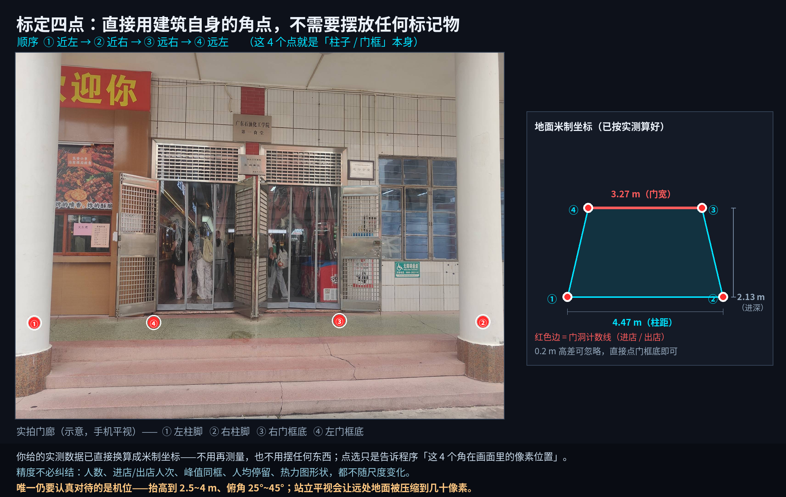

# 学校饭堂门口 · 人流量视频分析管线

数字孪生项目的**第一环**：把门口监控视频变成 UE5 能直接消费的逐帧人群轨迹 + 统计数据。

```
video.mp4 ─▶ 检测(人) ─▶ 跟踪(稳定ID) ─▶ 四点透视(像素→地面米制) ─▶ 统计+导出
                                                                  ├─ npc_tracks.json  给 UE5 蓝图（NPC 轨迹）
                                                                  ├─ realtime.json    给 UI 协作者（实时数据源）
                                                                  ├─ dashboard.html   离线占位看板（可替换/忽略）
                                                                  └─ analytics.json / tracks.csv / 热力图 / 核对视频
```

> **场景范围**：只做**饭堂门口外**的人流量（经过、进店、出店、门前滞留），不涉及饭堂内部功能。
> **场景建模与视频素材由你提供**，这里只有管线的代码，不含任何渲染/合成场景。
> **UI 页面由协作者实现**：本仓库只导出实时数据 `realtime.json`，不实现任何实时页面。
> **仓库地址**：https://github.com/Hi-Mr-clutch/canteen_twin

---

## 1. 你要准备的东西

**一台机位、一个门口**，录一段视频就够。单机位能算出这个门口的全部指标
（进出人次、峰值同框、人均停留、区域占用、热力图动线），不需要第二视角来"拼"数据。

| 素材 | 要求 | 放哪里 |
|---|---|---|
| 门口视频 | 固定机位、俯角 25°~45°、画面里有**门洞 + 门前地面 + 柱子/门框** | `data/input/door_front.mp4` |

> 相比两机位方案，单机位省掉了：两路对时、转角墙出镜、画面不重叠、90° 坐标旋转、
> 结果合并，以及"累计人数不能相加"这个口径坑。**不需要第二台设备，也不需要合并脚本。**

**尺寸已经量好了，不用再测，也不需要摆任何标记物**——柱子、门框本身就是最好的参照点：
边缘锐利、永久固定、不会被人踩走。`configs/entrance_measured.json` 里的地面梯形、
门洞计数线、门前平台区域都已按实测数据（柱距 4.47m / 门宽 3.27m / 进深 2.13m）算好，
你只要在首帧上点 4 下：



```bash
# 协作者从这里开始（本地已有项目可跳过）
git clone https://github.com/Hi-Mr-clutch/canteen_twin.git
cd canteen_twin

pip install -r requirements.txt

# 1) 标定：首帧上依次点 左柱脚 → 右柱脚 → 右门框底 → 左门框底（都是建筑角点，不摆标记）
#    --apply 会把结果直接写回配置，不用手工复制粘贴
python3 tools/calibrate_homography.py --video data/input/door_front.mp4 \
        --entrance-geometry 4.47,3.27,2.13 --apply configs/entrance_measured.json

# 2) 跑
python3 -m src.run_pipeline --config configs/entrance_measured.json
```

结果固定输出到 `out/entrance/`。

> 录之前必须确认什么（机位 2.5~4m、俯角 25°~45°、全程不动、避免逆光），
> 见 [`data/input/README.md`](data/input/README.md)。
>
> 若画面里门洞位置与配置预置的对不上，用 `tools/pick_zones.py` 在画面上重点一遍计数线/区域
> （叠加 1m 网格，点完生成校验图）。

> **统计口径**：单机位下"累计人数"就是被拍这个门这一时段的人数，没有重复计数问题；
> 但报告里别写成"全饭堂总人数"，建议标题用「第一食堂正门 · 人流量分析」。

一键脚本（标定之后用）：`bash tools/run_all.sh`

---

## 2. 输出文件

固定输出到 `out/entrance/`：

| 文件 | 给谁用 | 内容 |
|---|---|---|
| `npc_tracks.json` | **UE5 蓝图** | 每个 NPC 一条轨迹：帧号 + UE 世界坐标(cm) + 朝向 |
| `realtime.json` | **UI 协作者（实时）** | 逐帧累计快照 + 事件流 + 人员点位；字段见 `docs/realtime_data_contract.md` |
| `dashboard.html` | 占位（可忽略） | 管线自带的离线快照看板，正式 UI 由协作者实现 |
| `annotated.mp4` | 人工核对 | 叠加了检测框、ID、区域、计数线的视频 |
| `calibration_check.png` | 标定自查 | 1m 网格反投影回画面，网格贴地就说明标对了 |
| `heatmap.png` | 报告配图 | 门前地面人流密度（0.25m 栅格） |
| `tracks.json` | 二次开发 | 逐帧全量数据（含元信息、标定参数、区域定义） |
| `analytics.json` | 二次开发 | 统计汇总（人数/进出/区域停留/逐帧曲线） |
| `tracks.csv` | Excel | 同上，表格版 |

### 2.1 实时数据接口（UI 由协作者实现）

**本项目只提供数据，不实现 UI 页面。** `realtime.json` 是 UI 侧唯一数据源，
内嵌逐帧时间轴：每帧的当前人数 / 累计进出 / 累计人数 / 峰值 / 区域占用
+ 事件流 + 人员点位。每一帧都是「截至该帧」的累计快照，UI 直接取用、不要自己累加。

UE5 里 **NPC 和 UI 共用一个时钟**：同一个 Tick 读一次 `MediaPlayer.GetTime()`，
一路给 NPC 算 `CurFrame`，一路推给 UI 定位帧号 `f`。所以有人进门时，
引擎里的小人和面板数字同时变化，不需要额外对时。

给 UI 协作者：

| 需要 | 在哪 |
|---|---|
| 数据契约（字段表 / 定位公式 / 示例） | [`docs/realtime_data_contract.md`](docs/realtime_data_contract.md) |
| 无需真实视频的联调样例 | `examples/realtime_sample.json` |
| UE5 侧怎么把视频时间喂给页面 | [`docs/ue5_integration.md`](docs/ue5_integration.md) 第 5 节 |

`dashboard.html` 只是离线占位看板，正式 UI 可直接替换或忽略。

---

## 3. 管线各部分怎么做的

```
              ┌────────────────┐
 video ──────▶│ 检测 Detector   │  yolo / motion / auto（自动降级）
              └───────┬────────┘
                      │ bbox
              ┌───────▼────────┐
              │ 跟踪 Tracker    │  SimpleSORT：IoU + 中心距 + 衣色直方图
              └───────┬────────┘
                      │ 稳定 ID
              ┌───────▼────────┐
              │ 透视 Homography │  bbox 底边中点（脚点）→ 地面米制坐标
              └───────┬────────┘
                      │ (x_m, y_m) + 速度 + 朝向
              ┌───────▼────────┐
              │ 统计 + 导出      │  区域停留 / 进出计数 / 热力图 / 轨迹拼接
              └────────────────┘
```

### 3.1 检测：三档可切

| 模式 | 适用 | 说明 |
|---|---|---|
| `yolo` | **真实监控视频（推荐）** | ultralytics + COCO person 类，遮挡/并排分离能力强 |
| `motion` | 无权重、纯固定机位兜底 | MOG2 背景差分 + 连通域过滤，零权重依赖 |
| `auto`（默认） | 不确定时 | 先跑 12 帧 YOLO，检不到人自动切 `motion` 并打印原因 |

仓库已随附 `yolov8n.pt`（约 6MB），clone 下来就能直接跑 `yolo` / `auto`，不用另外下载权重。
若本地删掉了权重，把 `detector.yolo.weights` 改成**绝对路径**指向你自己的权重——
写成路径但文件不存在会立刻报错，不会卡住。`motion` 模式零权重依赖，固定机位也能跑。

### 3.2 跟踪：为了一件事——ID 不断

UE5 里一个 ID 就是一个 NPC，ID 断了就"消失重生"。所以做了三层保护：

- **中心距辅助匹配**：远处小目标 IoU 会掉到 0，此时靠中心距续 ID（`center_weight`）
- **衣色直方图**：两人并排/交叉时颜色比位置可靠，以乘子形式参与（位置不合理时不影响结果）
- **轨迹拼接后处理**：把"时间相邻 + 空间可达"的碎片接回同一个人（`src/postprocess.py`）

### 3.3 透视换算：四点标定

**用建筑自身的角点当标记即可**（柱子、门框、台阶沿），不需要摆任何东西——
把 4 个角点的**像素坐标**与已知的**米制坐标**（这里是一个等腰梯形）配对，解单应矩阵：

```bash
python3 tools/calibrate_homography.py --video data/input/你的视频.mp4 \
        --entrance-geometry 4.47,3.27,2.13
```

人的**脚点取 bbox 底边中点**（斜视下它就是人与地面的接触点），不是框中心。
跑完一定看 `calibration_check.png`：1m 网格贴住地面才算标对。**四个点的位置**决定计数和动线
准不准；W/H 填得差不改变人数、进出、峰值、停留，只影响速度数值和 UE 里 NPC 的绝对距离
（后者在 UE 里整体缩放即可对齐）。

> 门框底比柱脚高 0.2m（本门实测），四点因此略不共面，纵深比例会偏一成——**直接点门框底就行**，
> 想更准再沿门框竖边下移 0.2m 到与柱脚齐平处。两者都不影响人数和进出人次。

坐标转 UE5：`UE.X = (地面高度 − y_m)×100`，`UE.Y = x_m×100`，`Z=0`，单位 cm；朝向 `yaw` 已换算成 UE 角度。

### 3.4 统计口径（门口场景）

| 指标 | 定义 | 用途 |
|---|---|---|
| 累计人数 | 拼接去重后的轨迹数 | 这一时段来了多少人 |
| 进店 / 出店 | 轨迹穿越门洞计数线的方向 | 双向人流、净流入 |
| 峰值同框 | 逐帧画面内人数的最大值 | 门口最挤的时刻 |
| 门前区域占用 | 轨迹落在「门前缓冲区 / 门前通道」的帧数 | 门口是否拥堵、滞留多久 |
| 热力图 | 地面 0.25m 栅格累积人数 | 动线走向，报告里最好看的一张图 |

计数线方向：`counters[].p1 → p2` 的左手法向为"进"。方向反了就把 `inward_sign` 改成 `-1`，
或者把 p1/p2 对调。看 `annotated.mp4` 里计数线的 `in: x out: y` 是不是跟着人变就知道对不对。

---

## 4. 配置速查（`configs/entrance_measured.json`）

实测版配置里**只有 `image_points` 需要你填**，其余都已按门廊尺寸算好。字段含义如下：

```jsonc
{
  "video": { "path": "../data/input/door_front.mp4", "frame_step": 1, "max_frames": null },

  "detector": {
    "type": "auto",                          // auto | yolo | motion
    "yolo": { "weights": "yolov8n.pt", "conf": 0.25, "imgsz": 960, "device": "cpu" },
    "motion": {
      "min_area": 140, "min_height": 22,     // 按人像实际像素大小调（远处人小就调小）
      "foot_offset_ratio": -0.10             // 负数=脚点上移，用来剔除影子
    }
  },

  "tracker": {
    "iou_threshold": 0.15, "center_weight": 0.55, "center_gate": 0.8,
    "appearance_weight": 0.6, "max_age": 45, "min_hits": 2, "smooth": 0.45
  },

  "homography": {
    "image_points":  [[x1,y1],[x2,y2],[x3,y3],[x4,y4]],          // ← 只填这一项，标定工具点出来
    "ground_points": [[0,0],[4.47,0],[3.87,2.13],[0.6,2.13]],    // 米，等腰梯形：近边柱距 / 远边门宽 / 进深
    "ground_size_m": [4.47, 2.13],
    "ue_origin_cm": [0, 0, 0], "flip_x": false
  },

  "zones":    [ {"name":"porch","polygon":[[0,0],[4.47,0],[3.87,2.13],[0.6,2.13]]} ],
  "counters": [ {"name":"door","p1":[0.6,2.13],"p2":[3.87,2.13],"inward_sign":1} ]
}
```

`zones` / `counters` 里的坐标都是**地面米制坐标**，和 homography 同一套坐标系。
门洞计数线就是梯形的远边（两门框之间），`inward_sign` 控制哪边算"进"——
看 `annotated.mp4` 里线的 `in: x out: y` 是否跟人变就知道对不对，反了就改 `-1`。

调参顺序：**先标定 → 再 `min_area`/`min_height` 让框不漏不碎 → 最后 `max_age`/`appearance_weight` 治 ID 断裂**。

---

## 5. 已验证到什么程度

| 项 | 状态 |
|---|---|
| 单应/坐标映射/UE 换算 | 单元测试通过（往返误差 < 1e-3 像素） |
| 跟踪器 ID 保持 | 单元测试通过（单人保持 ID、两人交叉不串） |
| 检测器出框 | 单元测试通过（内存移动色块） |
| 导出 schema | 单元测试通过（tracks / npc_tracks 字段齐全） |
| 实时数据 | 单元测试通过（逐帧累计与最终汇总一致、事件类型 / 帧号契约齐全） |
| 全链路 | 用一段临时测试片段跑通，产出 9 个文件，约 600 fps（640×360） |
| 真实门口视频的精度 | **待你的素材**。到时按实际画面标定 + 调 `min_area`，并实测 recall / IDF1 |

`python3 tests/test_smoke.py` 可随时复跑；`data/input/` 里有视频时会自动加跑一次端到端。

---

## 6. 目录结构

```
canteen_twin/
├── src/
│   ├── run_pipeline.py      # 主入口：CLI + 主循环 + 可视化 + 汇总
│   ├── detector.py          # YOLO / 前景差分 / auto 降级
│   ├── tracker.py           # SimpleSORT（IoU + 中心距 + 外观）
│   ├── homography.py        # 四点标定、像素↔地面、UE 映射
│   ├── analytics.py         # 区域/停留/计数线/热力图
│   ├── postprocess.py       # 轨迹拼接
│   ├── exporter.py          # JSON / CSV / realtime.json / 占位看板
│   └── config.py            # 配置加载
├── tools/
│   ├── calibrate_homography.py   # 四点标定（交互点选 / 或用 --image-points）
│   ├── pick_zones.py             # 点选计数线/区域，自动换算成米（不用卷尺）
│   └── run_all.sh                # 一键：测试 → 跑管线
├── configs/
│   ├── entrance.json             # 门口场景通用配置（示例坐标，按需改）
│   └── entrance_measured.json    # 第一食堂正门 · 实测参数版（推荐）
├── data/input/                   # ← 你的视频放这里（附标定与录制说明）
├── examples/
│   └── realtime_sample.json     # 给 UI 协作者的联调样例数据
├── out/entrance/                 # 输出（不进仓库）
├── yolov8n.pt                    # YOLOv8n 权重（已随仓库附带）
├── tests/test_smoke.py           # 9 项冒烟测试
└── docs/
    ├── calib_points_demo.png     # 标定四点示意：点建筑角点，不用摆标记物
    ├── realtime_data_contract.md # ★ 给 UI 协作者的实时数据契约
    └── ue5_integration.md        # UE5 蓝图读 JSON / NPC 插值 / 视频同步 / UI 接线
```

---

## 7. 已知局限

| 局限 | 影响 | 补法 |
|---|---|---|
| 单目 2D 透视 | 只能算地面位置，算不出身高/姿态 | 门口人流量统计不需要 |
| 遮挡后 ID 会断 | UE5 里表现为 NPC 重生 | YOLO 能大幅缓解；`max_age` 调大可容忍更久 |
| 固定机位假设 | 机位一动标定作废，要重标 | 云台机位本期不支持 |
| 无 GPU 时较慢 | 1080p 大约 10~15fps | 上 GPU，或 `imgsz` 降到 640 / `frame_step` 抽帧 |
| 进出计数依赖轨迹穿线 | 贴线徘徊的人可能多计一次 | 计数线放在门口没有停留的位置 |
| **单机位只覆盖一个门** | 结论不能代表"全饭堂总人流" | 报告写明采样的是哪个门；要全覆盖再加第二路 |

下一步是 UE5 侧，接口和蓝图写法见 [`docs/ue5_integration.md`](docs/ue5_integration.md)。
