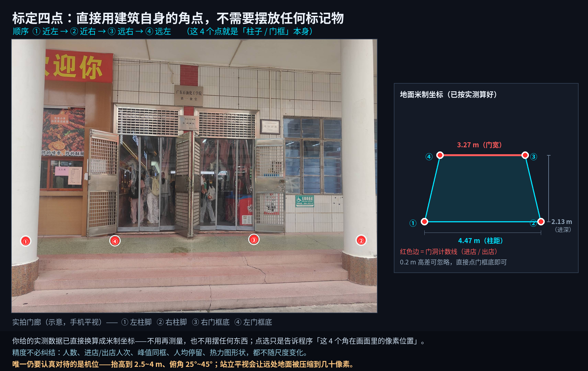

# 视频素材与标定

> **方案：一台机位、一个门口。** 只拍你量好尺寸的那个正门，一段视频跑一条管线。
> 不用摆标记物——柱子、门框、台阶沿就是现成的参照点，边缘锐利、永久固定；
> 尺寸已换算好写进配置，你只需在视频首帧上**点 4 下鼠标**。

---

## 1. 你要做的三件事

| 步骤 | 做什么 | 花多久 |
|---|---|---|
| ① 录视频 | **一台设备**固定机位录门口人流（要求见 §6） | — |
| ② 标定 | 在首帧上点「左柱脚 → 右柱脚 → 右门框底 → 左门框底」，结果自动写回配置 | 1 分钟 |
| ③ 跑管线 | `python3 -m src.run_pipeline --config configs/entrance_measured.json` | 几分钟（看视频长度） |

**不需要**第二台设备、不需要两路对时、不需要坐标旋转、不需要合并。

---

## 2. 为什么不需要标记物

标定本质上只需要一件事：**画面上 4 个能点准的位置，它们在现实中的坐标是已知的。**

你已经给出了门廊的真实尺寸，那么门廊本身就把这 4 个位置提供好了：

| | 临时摆标记物 | 用建筑自身角点 |
|---|---|---|
| 需要准备 | 4 个瓶子 / A4 纸 / 粉笔 | **什么都不用** |
| 边界清晰度 | 纸会翘边、瓶子有高度（俯拍产生视差） | 柱子与地面交界、门框竖边，**边缘锐利** |
| 会不会动 | 被人踢走、被风吹跑 | **永久固定** |
| 录制时要不要清场 | 要，还得录完再拿走 | 不用，直接拍 |

> 之前建议摆标记物，是因为当时还不知道门廊尺寸、需要"自己造一把尺子"。
> 现在尺寸有了，尺子就是建筑本身。

---

## 3. 标定怎么点



### 命令

```bash
python3 tools/calibrate_homography.py --video data/input/door_front.mp4 \
        --entrance-geometry 4.47,3.27,2.13 \
        --apply configs/entrance_measured.json
```

弹出窗口后，在首帧上按顺序点 4 个点（点错了按 `ESC` 重来）：

```
① 近左 = 左柱脚           ② 近右 = 右柱脚
③ 远右 = 右门框竖边底部    ④ 远左 = 左门框竖边底部
```

点完按 `回车`，工具会：

- 自动算出地面梯形（不用你手算）
- 输出门洞计数线和门前平台区域
- **把结果直接写回配置文件**（`--apply`），不用手工复制粘贴
- 生成 `*_check.png` **校验图**：1m 网格应该贴着地面，网格爬到墙上就说明点错了

然后直接跑：

```bash
python3 -m src.run_pipeline --config configs/entrance_measured.json
```

> 不想用 `--apply` 也行：工具会打印一段 JSON，手工贴进配置的 `homography` 字段即可。
> 没有桌面环境（远程服务器）时：先 `--dump-frame out/frame0.png` 导出首帧，
> 用看图软件读出 4 个像素坐标，再用 `--image-points "x1,y1 x2,y2 x3,y3 x4,y4"` 传入。

---

## 4. 精度：为什么"不精确"几乎没有代价

你说过不用那么精确——这个判断是对的，因为**尺度根本不进这些指标的计算**：

| 指标 | 尺度（米制）填错会不会变 |
|---|---|
| 累计人数、进店 / 出店人次、峰值同框、平均同框 | **完全不变**（只看检测框和是否穿过线） |
| 人均停留时长、逐帧人数曲线 | **完全不变**（只按帧数和 fps 算） |
| 门前区域占用、热力图的动线形状 | **完全不变**（区域和标定是同一套坐标） |
| 速度 m/s、热力图上标的"米"、UE 里 NPC 走的绝对距离 | 会按比例偏，但**在 UE 里整体缩放即可对齐** |

所以真正要在意的只有**4 个点的位置对不对**（决定计数线是否横在门洞上、区域是否贴地），
而不是尺寸数字有多准。0.2m 高差、柱子外沿还是柱心这类问题，影响的是最后一行那几项，
对报告里的核心数字没有影响。

---

## 5. 想更精确时的两个可选项（不做也行）

| 项 | 情况 | 影响 | 怎么处理 |
|---|---|---|---|
| **门框底比柱脚高 0.2m** | 四点略不共面 | 纵深比例偏约 10%（俯角 35° 时约 0.29m） | 直接点门框底就行；想更准就沿门框竖边**下移 0.2m** 到与柱脚齐平处再点 |
| **柱距量外沿还是柱心** | 画面上点的是柱子可见外边 | 差一个柱径（约 0.5m / 4.47m ≈ 11%） | 已按外沿到外沿 4.47m 处理，无需改动 |

两者都只影响纵深或横向的比例，**不影响人数与进出人次**。想省事就都忽略。

> **范围提醒**：这个梯形只覆盖门廊平台（4.47m × 2.13m），所以热力图会集中在门口这一小块。
> 人数、进出人次、峰值同框是**全画面**统计，不受影响。想让热力图铺满台阶前，
> 把近边两点往外移到台阶下的地面（纵深再用 iPhone 测距仪补一段，这一步才是真的需要量）。

---

## 6. 录之前必须确认的事（录完就改不了）

| 事项 | 要求 | 不做的后果 |
|---|---|---|
| **机位高度 / 俯角** | 抬高到 **2.5~4m**，俯角 **25°~45°** | 站立平视（手机手持）时远处地面被压缩到几十像素，1 像素≈1~2 米，脚点会乱飘，检测也跟着不稳 |
| **机位固定** | 三脚架压稳，全程不动 | 中途碰一下，标定作废，必须重标 |
| **画面包含门洞 + 门前地面 + 柱子/门框** | 门洞用于计数线，柱子门框用于四点标定 | 缺任一样，要么没法计数，要么没法标定 |
| **避免逆光和强阴影** | 顺光或侧光 | 逆光下人变剪影，检测和脚点都会飘 |

参考照片里那几张是**站着手持平视**拍的，只能用来确认"点哪 4 个位置"，
**不能当最终机位**。

> 之前两机位方案里的「时间同步、转角墙出镜、画面不重叠」现在**全部不需要了**——
> 那是多路合并才有的约束，单机位一台设备自然满足。

---

## 7. 怎么跑

```bash
# 1) 标定（首帧点 4 个建筑角点，结果自动写回配置）
python3 tools/calibrate_homography.py --video data/input/door_front.mp4 \
        --entrance-geometry 4.47,3.27,2.13 --apply configs/entrance_measured.json

# 2) 跑管线
python3 -m src.run_pipeline --config configs/entrance_measured.json
```

结果固定输出到 `out/entrance/`，共 8 个文件（轨迹 / 看板 / 核对视频 / 热力图 / CSV 等）。

### 统计口径（单机位下全部直接可信）

- **累计人数** = 这一路去重后的轨迹数，就是"这个门口这一时段来了多少人"，**没有重复计数问题**
  （两机位才有"同一个人被两路各算一次"的麻烦）
- **进店 / 出店** = 穿越门洞计数线的方向，**净流入 = 进 − 出**
- **峰值同框 / 人均停留 / 区域占用 / 热力图** = 单路视频内直接统计

> 唯一要注意的口径：报告里别写"全饭堂总人数"。单机位只代表**被拍的这个门**，
> 建议标题写成「第一食堂正门 · 人流量分析」。想覆盖全部入口，以后加第二路再谈合并。

一键脚本（标定之后用）：`bash tools/run_all.sh`

---

## 8. 现场记录（可选，想留档就填）

| 项目 | 值 |
|---|---|
| 拍的是哪个门 | |
| 开录时间 | |
| 机位高度 / 俯角（估） | |
| 视频时长 / 帧率 / 分辨率 | |
| 4 个角点是否都清晰可见 | |

---

## 9. 注意

- **换机位、改焦距、动过摄像头 → 必须重标**，否则位置全部错位。
- 门口若有人长时间站着不动（等人、刷手机），`motion` 前景差分模式会逐渐把他"学"成背景；
  真实素材用 `yolo` 检测器没这个问题（默认 `auto` 会先试 yolo，检不到人自动降级）。
- `counters` / `zones` 必须和标定用**同一套坐标**。配置里已按实测几何预置；
  如果画面里门洞位置和预置的对不上，用 `tools/pick_zones.py` 在画面上重点一遍。
