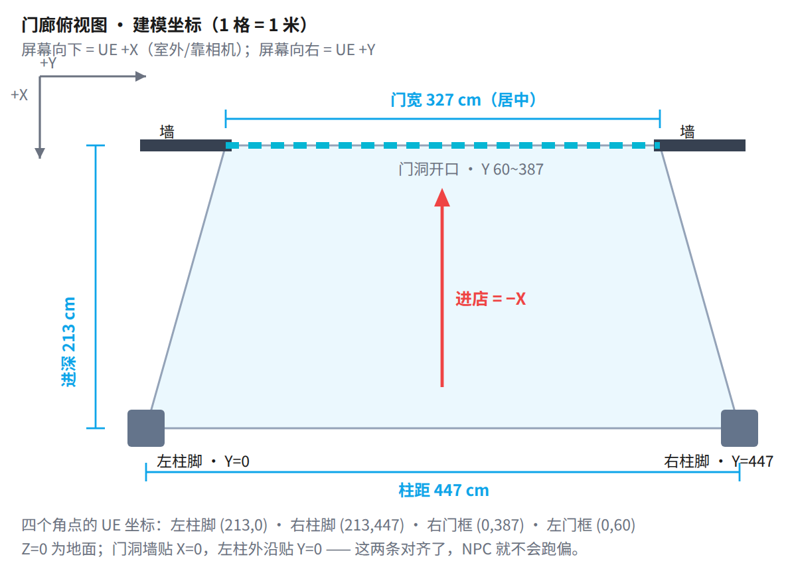

# 门廊建模规格（UE5 侧）

> 给建模 / 场景同学看的。目标只有一个：**UE5 里建出来的门廊，和管线导出的 NPC 坐标严丝合缝对上**。
> 按本文建完不需要做任何手动对齐——跑完管线，人就会站在该站的位置。
>
> **全文单位是厘米（cm）**，也就是 UE 的默认单位 `uu`。除非特别标注为「米」。

---

## 0. 先记住三句话

1. **1 米 = 100 单位**。按实测数值直接建，不要"建小一点后期放大"。
2. **门洞墙贴 `X=0`，左柱外沿贴 `Y=0`，地面 `Z=0`**。这三条对齐，人就永远不会跑偏。
3. **不要在 UE 里旋转或缩放整个场景**。坐标是写死的相对值，一转就全反。



---

## 1. 坐标是怎么来的

管线取每个人**检测框底边中点**（脚点），先按四点标定换算成地面米制坐标，再换成 UE 世界坐标。换算就是下面这三行：

```text
UE.X = (2.13 - y_m) * 100     # y_m 是从柱脚往里量的进深，0 ~ 2.13
UE.Y = x_m * 100              # 横向，0 ~ 4.47
UE.Z = 0                      # 脚永远踩在地面
```

- 公式里的 `2.13` 就是进深（配置 `homography.ground_size_m[1]`）。**改配置里的进深，公式会跟着变**，所以建模尺寸和配置必须一致。
- `y_m = 0` 在柱脚这条线（室外、靠相机）；`y_m = 2.13` 在门洞面。
- 所以 **`X=0` 是门洞所在的墙面，`X=213` 是柱脚外沿**，**进店方向是 −X**。

几个典型位置对照：

| 位置 | 地面 `(x_m, y_m)` | UE `(X, Y, Z)` |
|---|---|---|
| 左柱脚 | (0, 0) | (213, 0, 0) |
| 右柱脚 | (4.47, 0) | (213, 447, 0) |
| 门洞正中（门槛处） | (2.235, 2.13) | (0, 224, 0) |
| 门外正中、距门 1 m | (2.235, 1.13) | (100, 224, 0) |
| 门内正中、进店 1 m | (2.235, 3.13) | (−100, 224, 0) |

### 朝向（yaw）

管线按人的移动方向算好了 `yaw`（度，绕 Z 轴），蓝图直接 `SetActorRotation(FRotator(0, yaw, 0))` 即可，**不用再换算**。对应关系：

| 人往哪走 | yaw |
|---|---|
| 进店（−X） | 180° |
| 出店（+X） | 0° |
| 画面右方（+Y） | 90° |
| 画面左方（−Y） | −90° |

前提是**模型默认正面朝 +X**（见 §4.3）。

---

## 2. 建模尺寸表

| 项目 | 实测 | UE 单位 | 位置说明 |
|---|---|---|---|
| 柱距（外沿→外沿） | 4.47 m | **447** | 两根柱脚分别落在 `Y=0`、`Y=447` |
| 门洞净宽 | 3.27 m | **327** | `Y=60` ~ `Y=387`，**正好在柱距正中** |
| 柱到门的进深 | 2.13 m | **213** | 柱脚线 `X=213`，门洞面 `X=0` |
| 柱高 | 4.38 m | **438** | `Z=0` ~ `438` |
| 门框底高出柱脚 | 0.20 m | **20** | 建议不做真实落差，见 §6 |
| 门洞高度 | **尚未测量** | — | 建模必须，见 §6 |

> 门洞是**居中**的：柱距中心 `Y=223.5`，门洞中心也是 `(60+387)/2 = 223.5`。
> 如果实测发现门偏一侧，以实测为准，但 `homography.ground_points` 要同步改。

---

## 3. 四个基准角点

这四个点是标定用的，也建议在 UE 里当"基准"检查。建完后它们的 UE 坐标必须精确落到下表：

| 角点 | 在图纸上的位置 | UE 坐标 |
|---|---|---|
| 左柱脚 | 室外、靠相机、左侧 | `(213, 0, 0)` |
| 右柱脚 | 室外、靠相机、右侧 | `(213, 447, 0)` |
| 右门框底 | 门洞面、右侧 | `(0, 387, 0)` |
| 左门框底 | 门洞面、左侧 | `(0, 60, 0)` |

"左 / 右"以**站在室外、面朝门口**为准：左手边是 `Y=0`。

标定时在视频首帧点这四个点，顺序是 **左柱脚 → 右柱脚 → 右门框底 → 左门框底**。示意图见 [`calib_points_demo.png`](calib_points_demo.png)。

---

## 4. 五条硬规则

### 4.1 单位

1 m = 100 uu。UE 的 `Unit Scale` 保持 `1.0`，导入 FBX 时也不要去改缩放系数。

### 4.2 轴必须对齐，且不许整体旋转 / 缩放

- 门洞墙（含门洞的那个立面）**贴 `X=0`**
- 左柱外沿**贴 `Y=0`**
- 门前地面**在 `Z=0`**

坐标是相对这套基准算出来的。**只要在 UE 里转一次场景、或整体缩放一次，所有人的位置立刻全错**，而且很难查。宁可回建模软件改，也别在 UE 里用旋转/缩放去"凑"。

### 4.3 模型正面朝 +X

UE 的角色默认面向 `+X`，管线的 `yaw` 也是按这个基准给的。

- 用 Mannequin / 标准 Character：默认就对，不用管。
- 自己做的 NPC 模型：确认导入 UE 后**脸朝 `+X`**。如果朝 `−Y`，人会在场景里全程侧着走。

### 4.4 NPC 的轴心（pivot）放在脚底

- 用 `Character` 类：胶囊体底部对齐脚底即可，默认行为正确。
- 用 `StaticMesh` / 普通 `Actor`：把 pivot 设在**两脚之间的地面点**。设在腰部会让人陷进地里半个身高。

### 4.5 地面要铺大一圈

标定的四点只覆盖 `4.47 m × 2.13 m` 的门廊平台。**人会走到这个范围之外**（画面边缘、台阶下），这时坐标是外推出来的，仍然可用，但需要脚下有地面。

建议：门前再往外铺 **4~5 m**，左右各外扩 **2 m**，门内再铺 3 m 以上。否则 NPC 会"走在空中"。

---

## 5. 场景摆在世界哪里

**整块门廊放哪里都行，只是整体平移。** 缺省就按上表放在：

```
门洞面  ->  X = 0
左柱外沿 ->  Y = 0
地面    ->  Z = 0
```

如果不想放在世界原点，**改配置里的 `homography.ue_origin_cm`**：

```json
"ue_origin_cm": [0.0, 0.0, 0.0]    // [X, Y, Z] 偏移，单位 cm
```

导出时所有坐标会整体加上这个偏移，一次改完，不用逐个挪 NPC。

> **不要**在 UE 里挪场景 Actor 而不同步改配置——两边会错开。
> 也不要靠旋转场景来"把门口朝向调好看"。

### 左右建反了的兜底

如果发现 Y 方向整体镜像了（人从左边进、模型门在右边），配置里有：

```json
"flip_x": false   // 改成 true 会把 Y 取反
```

但这会让 Y 变成 `−447 ~ 0`，场景也得跟着镜像。**能用重建解决就别用这个开关**。

---

## 6. 还需要补量的三个尺寸

| 缺什么 | 为什么要 | 不量的后果 | 建议 |
|---|---|---|---|
| **门洞高度** | 建模开洞必须有 | 洞开太低，NPC 会从墙里穿过去 | 量"门框上沿到地面"，常见 210~240 cm |
| **墙厚** | 视觉真实感 | 无（不影响走位） | 20~30 cm 估即可，墙体向 **−X（室内）** 方向延伸，让 `X=0` 是墙的外表面 |
| **0.2 m 高差发生在哪一段** | 决定台阶做在哪 | 做错位置 NPC 会浮空/穿模 | 建议**不做真实落差**，见下 |

### 关于 0.2 m 高差

管线和 UE 里 **NPC 的 `Z` 恒为 `0`**（脚本 `ground_to_ue` 里写死）。所以：

- 如果把门廊平台做到 `Z=0`、室外地面做到 `Z=−20`，NPC 走到室外会**浮空 20 cm**；
- 如果做 20 cm 的门槛，NPC 进店会**直接穿过去**；
- **最省事也最稳的做法：整个可走区域统一 `Z=0`，高差只用贴图/收边表现**，不要做真实几何落差。

20 cm 在俯视远景里几乎看不出来，不值得为它引入穿模风险。

---

## 7. 建歪了会是什么现象

| 现象 | 原因 | 修法 |
|---|---|---|
| 所有人整体偏出门口 | `X=0` / `Y=0` 没对齐 | 回建模软件挪，别在 UE 里挪 |
| 人朝反方向走 | 场景被旋转了 180° | 取消旋转 |
| 人陷进地里 / 浮空 | pivot 不在脚底 | 改轴心到脚底 |
| 人全程侧着走 | 模型正面不是 `+X` | 建模软件里转朝向 |
| 门显得太宽 / 太窄 | 只拉了一个轴 | 整体等比缩放，别单独拉宽 |
| 人从墙里穿过去 | 门洞开得太小 / 位置偏 | 核对 §2 的 `Y=60~387` |
| 人走到空中 | 地面没铺够 | 按 §4.5 补地面 |
| 靠近门口的人位置对、远处偏 | 标定四点没点准 | 重跑标定工具，看 `calibration_check.png` |

---

## 8. 建完怎么自检

**方法一：用立方体当尺子**

在 UE 里拖一个 `100 × 100 × 100` 的立方体：

- 门宽应该约等于 **3.3 个**立方体
- 柱距应该约等于 **4.5 个**
- 柱高应该约等于 **4.4 个**

**方法二：用真实轨迹点验证**

跑一次管线，从 `out/entrance/npc_tracks.json` 取第一帧某人的 `x, y, z`，在 UE 里放个球：

- 球应该落在**门口地面**上，不在墙上、不在空中
- 多取几个人、几帧，应该都贴着地面走

**方法三：网格对照**

看 `out/entrance/calibration_check.png`，里面贴地的 1 m 网格，应该和 UE 地面的 1 m 网格是同一比例。网格"爬到墙上"就说明标定四点有问题，不是建模问题。

---

## 9. 不需要建的东西

| 不用做 | 原因 |
|---|---|
| 整栋饭堂 | 管线只覆盖门口这一小块，**先建门廊局部切片**就够演示，整栋楼后期补 |
| 可开合的门扇 | 会挡住 NPC 走位。做**常开状态**或不建 |
| NPC 的专用模型 | 用 UE 自带 Mannequin 就够，几十个人不需要考虑性能 |
| 门前平台以外的精确地面 | 铺一块大平面即可，不需要细节 |
| 0.2 m 真实落差 / 门槛 | 见 §6，做了反而穿模 |

---

## 10. 和别的文档的关系

| 文档 | 讲什么 |
|---|---|
| 本文 | **建模尺寸、坐标、轴向**（场景同学看这份） |
| [`calib_points_demo.png`](calib_points_demo.png) | 视频首帧上点哪 4 个建筑角点 |
| [`ue5_integration.md`](ue5_integration.md) | 蓝图怎么读 JSON、怎么按视频时间驱动 NPC、怎么嵌 UI |
| [`realtime_data_contract.md`](realtime_data_contract.md) | UI 用的 `realtime.json` 字段契约 |
| [`../data/input/README.md`](../data/input/README.md) | 录制要求、标定步骤、现场记录表 |

坐标数值的最终来源永远是 `configs/entrance_measured.json` 里的 `homography` 段。**图纸和配置冲突时，以配置为准**，并同步改另一边。
